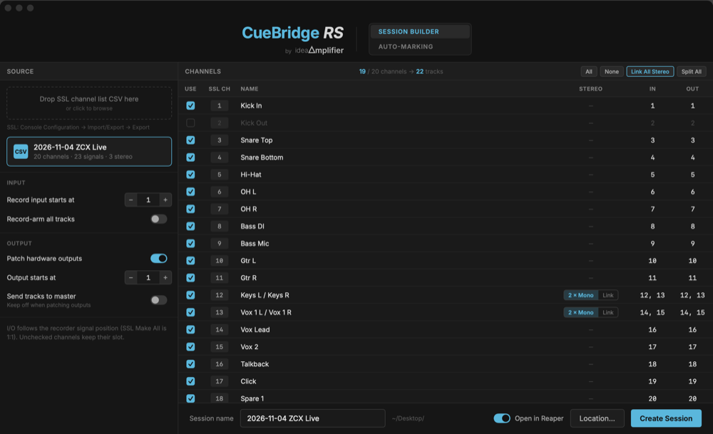
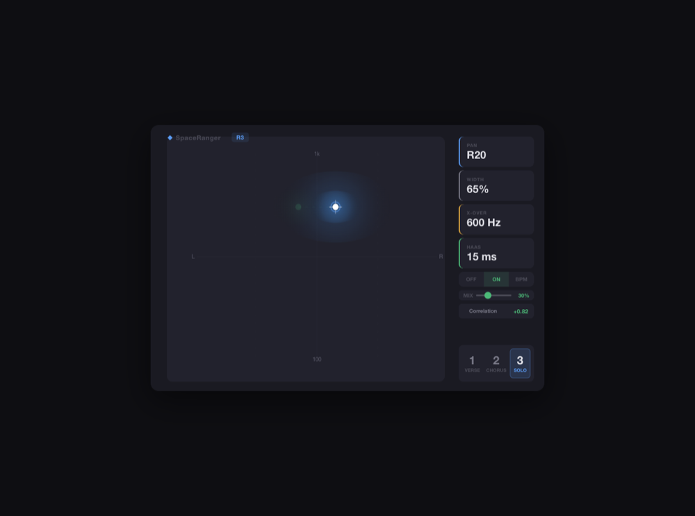

  

---

## 作品

<table>
<tr>
<td width="52%" valign="top">

### CueBridge RS
**SSL Live ↔ REAPER**

現場多軌錄音的橋樑：控台每個 scene 變成 REAPER 的具名 marker；控台自己的 transport 直接控制 REAPER；SSL 的 channel list 一鍵建好專案。一條網路線，不需要 ipMIDI 驅動。

`macOS 13+` · `v0.2.8` · **免費**

→ 2026-11 公開釋出

</td>
<td width="48%">

</td>
</tr>
<tr>
<td width="52%" valign="top">

### SpaceRanger
**立體聲像工具（VST3 / AU）**

真 pan、spectral crossover、Haas 延遲，zero-latency。為現場外掛載體設計，不是為了在錄音室裡慢慢調。

`VST3 / AU` · `v0.6.2` · **邀請制 beta**

</td>
<td width="48%">

</td>
</tr>
<tr>
<td width="52%" valign="top">

### PhatAnchor
**多麥相位對齊（VST3 / AU）**

對齊同一樂器多支麥克風（聚焦 kick in/out）的相位與時間。鐵則：一切手動觸發——AUTO 只填旋鈕，不鎖旋鈕，plugin 永不自己改變音訊。

`VST3 / AU` · **開發中**

</td>
<td width="48%" valign="top">

### Baseline
**LTC timecode 標記管理**

把演出的 LTC 時間碼、marker 與 setlist 整理成一個工作檔，演出時送到控台與外掛載體。

`macOS` · **私有工具**

</td>
</tr>
</table>

## 正在做

- **CueBridge RS v0.2.8** — 公開釋出（2026-11）
- **SpaceRanger 公開 beta** — 20 人，12/10 截止，結束後決定正式版／付費／停止
- **北京小班工作坊** — 2026-12，用這些工具當教材

## 背景

| | |
|---|---|
| **20 年** | 現場擴聲，從 livehouse 到音樂節、體育館、體育場 |
| **留學** | University of Westminster |
| **現在** | 台北／北京，獨立開發現場工具與教學 |

## 我做工具的三條線

1. **zero-latency** — 現場不能有延遲，DSP 鏈上不允許有 lookahead。
2. **手動優先** — 自動功能只在你按下去的時候動一次，不會在你沒注意的時候改變聲音。
3. **不搶控台** — 工具是外掛在流程旁邊，不是取代控台或 DAW。

---

ideaAmplifier · YO Hsiangchu Yu · 2026

