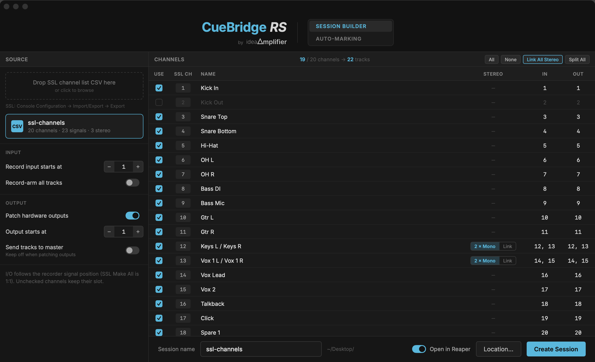
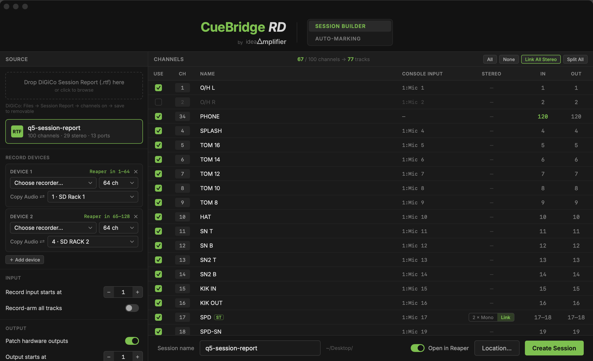
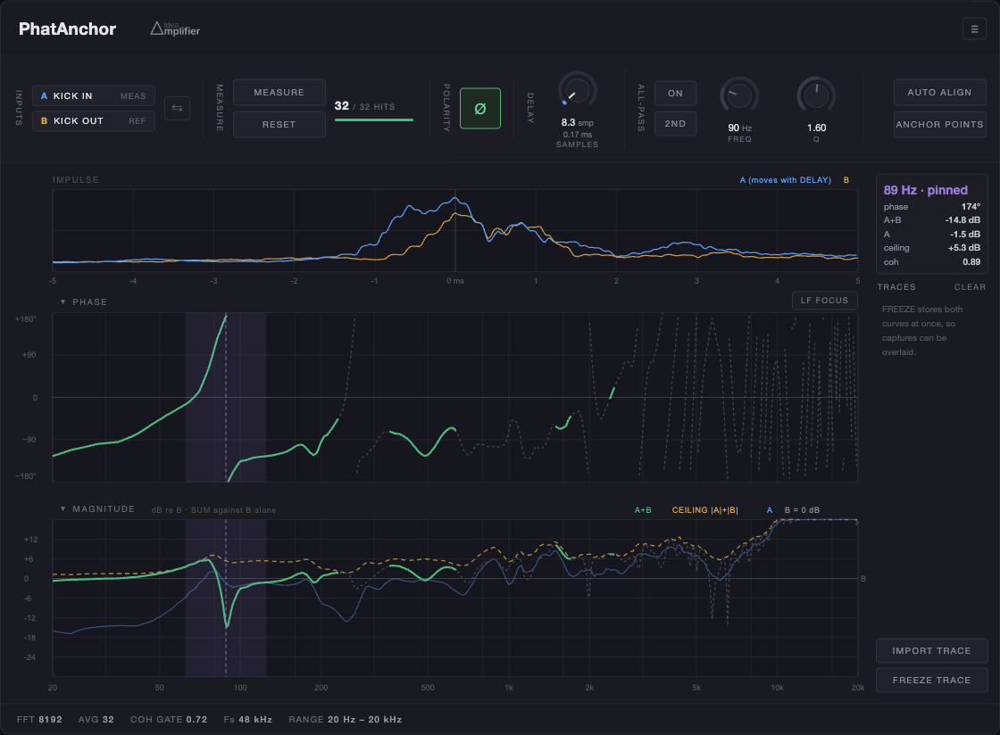

  

# YO（游翔竹）

**FOH engineer, 20+ years · Taipei / Beijing**

I build the tools I wish existed on stage — the kind you can set up in ten minutes of soundcheck and trust for the whole show. MA Audio Production (University of Westminster). Britannia Row Productions trained. Coralworks member.

---

## Work

<table>
<tr>
<td width="52%" valign="top">

### CueBridge RS
**SSL Live ↔ REAPER**

Every SSL scene becomes a named marker in REAPER. The console's own transport (Rec / Stop / Play / Loop / Rtz / Prev / Next) drives the DAW over ipMIDI (HUI). One network cable from Mac to SSL Connectivity port — no ipMIDI driver needed.

`macOS 13+` · `v0.2.8` · **Free**

→ [Repo & download](https://github.com/IdeaAmplifier/CueBridge-RS)

</td>
<td width="48%">

</td>
</tr>
<tr>
<td width="52%" valign="top">

### CueBridge RD
**DiGiCo → REAPER**

Same idea, DiGiCo desk. Reads the console's Session Report RTF to build a matching REAPER project (I/O follows Copy Audio). Snapshot recall → named marker via iPad OSC protocol. MMC transport from the desk's MIDI Out.

`macOS 13+` · `v0.2.4` · **Beta**

→ Awaiting full on-console verification

</td>
<td width="48%">

</td>
</tr>
<tr>
<td width="52%" valign="top">

### SpaceRanger
**Stereo imaging · VST3 / AU**

True pan, spectral crossover, Haas delay — all zero-latency. Built for third-party plugin hosts on stage (LiveProfessor, SuperRack, Reaper), not for sitting in a studio and tweaking.

`VST3 / AU` · `v0.6.2` · **Invitation beta**

→ 20-person beta, closes 12/10

</td>
<td width="48%">

</td>
</tr>
<tr>
<td width="52%" valign="top">

### PhatAnchor
**Multi-mic phase alignment · VST3 / AU**

Align phase and time across multiple mics on the same source (focus: kick in + kick out). The iron rule: **manual trigger only**. AUTO computes once when you press it — fills the knobs, never locks them. The plugin never changes audio on its own.

`VST3 / AU` · `v0.1.1` · **In development**

</td>
<td width="48%">

</td>
</tr>
<tr>
<td width="52%" valign="top">

### Baseline
**LTC timecode → markers → console**

Turn a show's LTC timecode, markers, and setlist into one working file. At show time, it drives the console (MIDI CC/PC) and plugin hosts (OSC).

`macOS` · `v1.2.0` · **In development**

</td>
<td width="48%">

</td>
</tr>
</table>

## Now building

- **CueBridge RS v0.2.8** — public release, Nov 2026
- **SpaceRanger public beta** — 20 people, closes 12/10. Then decide: ship / charge / stop
- **Beijing workshop** — Dec 2026, small group, using these tools as curriculum

## The path

- **2006–2013** · Sound engineer at 地下社會 and The Wall Live House — the Taipei indie scene that taught me how to mix before anyone paid attention
- **2009–2014** · BA Radio & TV, Shih Hsin University → MA Applied Media Arts, Taipei National University of the Arts → MA Audio Production, **University of Westminster** (London)
- **2014** · Live Sound Technology training, **Britannia Row Productions**, UK
- **2015–2017** · Sound tech execution at 必应创造; Lecturer, Communication Arts, **NTUA**
- **2017–2018** · Guest lecturer, Music Technology, **Beijing Modern Music Conservatory**
- **2018–present** · Member / FOH engineer, **Coralworks（山弧工作组）**
- **Now** · Split Taipei / Beijing. Mixing shows (42+ a year), teaching, building tools for the trade. Working toward a small team and a director role — the kind where you design the show and someone else pulls the faders.

## Three lines I don't cross

1. **Zero-latency.** No lookahead on stage. DSP chains don't get to borrow time from the future.
2. **Manual-first.** AUTO only fires when you press it. Fills knobs, doesn't lock them. The plugin never changes audio on its own.
3. **Don't replace the console.** Tools sit beside the workflow, not in place of the desk or DAW.

---

ideaAmplifier · YO Hsiangchu Yu · 2026

